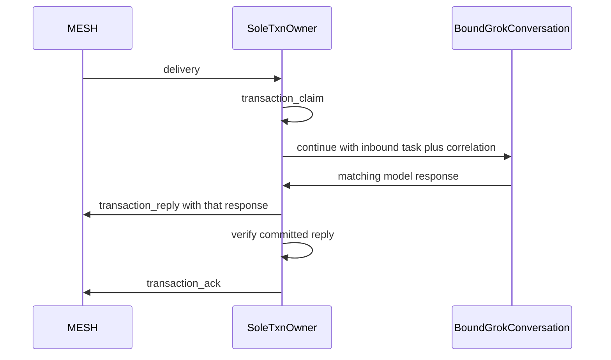

# Interactive Grok Bob (conversation-owner spike)

## Ordering (locked)

1. Read-only Sand API and authentication inventory.
2. Lock **conversation-owner mode** (not mirror mode) as the interactive goal.
3. Run the strengthened, no-mailbox-claim conversation spike.
4. Produce a **go / no-go / inconclusive-unsafe** handoff.
5. **Independently** review and publish the App Server binding change (explicit file allowlist + verification).
6. Only on **go:** design a conversation adapter with one durable transaction owner and the E2E contract below.

Do **not** make committing or pushing App Server work a prerequisite for the spike. The Mini `main` worktree is dirty and the bind CLI is still untracked; treating that path as “already shipped” is inaccurate until a separate allowlisted publish lands.

## Goal that counts as interactive Bob

**Conversation-owner mode only:**

- An operator-bound existing Grok conversation receives the inbound MESH task.
- That conversation **reasons** and produces the model response.
- The **sole** transaction owner commits **that** response to MESH (`transaction-reply`), then acks.

**Mirror mode is explicitly out of scope for a green interactive outcome.** Headless Bob doing the work while the visible chat only gets a transcript copy does **not** prove interactive Bob communication. Mirror may be documented later as a non-interactive UX option; it must never be scored as spike **go**.



## Current headless baseline (contrast, not the target)

Today: watch hint → webhook → Sand routine `mesh-bob-wake-drain` → claim/reply/ack. Visible Grok chat is not in the loop. That path stays the production A2A owner until conversation-owner mode is proven and designed.

## Phase 1 — Read-only API inventory (non-mutating)

Inventory before any inject:

- Conversation list / get / continue / run-turn APIs vs routine-only run.
- Authentication boundaries and credential types (what must never be used as HTTP bearer).
- Stable conversation ID shape and whether IDs survive reconnect/restart.
- Whether response correlation is possible (turn ids, reply-to, run ids).
- Explicitly **exclude** focus/open-UI automation as evidence of continuation.

Output: inventory section in the spike handoff (capabilities table + auth notes).

## Phase 2 — Mode lock

Record in the handoff:

| Mode | Who reasons | Who commits MESH reply | Counts as interactive go? |
| --- | --- | --- | --- |
| Conversation-owner | Bound conversation | Sole txn owner using that response | Yes |
| Mirror | Headless routine | Headless routine; UI gets copy | No |

## Phase 3 — Strengthened conversation spike (no mailbox claim)

**Preconditions**

- Operator-selected **existing** conversation ID (not “latest chat”).
- Capture before-transcript / conversation metadata.
- No `transaction-claim-*` / no MESH mailbox mutation during the spike.

**Procedure**

1. Insert one harmless uniquely tagged prompt into that conversation (single nonce).
2. Wait for a **new model-generated** response in the **same** conversation.
3. Read back prompt + response under the **same stable conversation ID**.
4. Confirm **no new conversation** was created.
5. Reconnect/restart the client or API session and re-read; ID and transcript still match.
6. Preserve before/after transcript evidence in the handoff.

**Pass (go)** — all of:

- Existing operator-selected conversation ID.
- Unique nonce prompt inserted into that conversation.
- New model-generated response in the same conversation, correlated to the nonce.
- Readback shows both under that stable ID.
- No new conversation created.
- Stability across reconnect/restart.
- No mailbox claim during the spike.

**No-go**

- Only routine/automation-run APIs exist; no conversation-target continue/run-turn surface.

**Inconclusive / unsafe** (document and **stop without implementation** — not green):

- Unstable or rotating conversation IDs.
- Unsupported or unsafe credential requirements.
- API creates a new chat instead of continuing the bound one.
- No reliable response correlation (cannot tell which model output matches the nonce).
- Works only via UI automation / focus hacks.
- Any other path that cannot support the E2E ownership sequence safely.

## Phase 4 — Handoff artifact

Write `docs/triangle-client/HANDOFF-interactive-grok-bob-spike-YYYY-MM-DD.md` with:

- API inventory + auth boundaries.
- Mode lock (conversation-owner vs mirror).
- Spike procedure, nonce, conversation ID, before/after evidence.
- Verdict: **go** | **no-go** | **inconclusive-unsafe**.
- Recommendation: stop, or proceed to adapter design.

## Phase 5 — Separate App Server bind publish (independent track)

Not a spike blocker. When ready:

- Explicit file allowlist for dynamic thread-bind only (bind CLI, `shared-codex-app-server` rebind/merge, allowlist entries, tests, skill/docs for bind).
- Do **not** broadly commit unrelated dirty worktree noise.
- Verify unit tests; commit; push as its own change.
- Correct docs that implied the bind CLI was already on `origin/main`.

## Phase 6 — Only on go: conversation-owner adapter design

Sole durable transaction owner (one profile / one claimer). End-to-end contract:

```text
MESH delivery
  → sole transaction claim
  → continue bound conversation (inbound task + correlation id / nonce)
  → wait for the matching model response (timeout → record-failure / retry policy)
  → transaction-reply using that response (not an unrelated human message)
  → verify committed MESH reply (threaded, correct text)
  → transaction-ack
```

Design must also specify:

- **Correlation:** map deliveryId / claimId ↔ conversation turn / nonce; reject unmatched outputs.
- **Timeouts:** bounded wait; fail closed to `transaction-record-failure` (or equivalent) without ack-as-success.
- **Restart recovery:** resume open claim; re-read inbound; do not double-reply; re-attach bound conversation ID from durable binding.
- **Duplicate responses:** idempotent reply key; ignore late duplicates after ack.
- **Human noise rule:** unrelated human messages in the bound conversation must **never** become MESH replies; only the correlated model response to the injected task may commit.
- **Binding:** durable `conversationId` (hot-rebind analog to App Server `threadId`); never “latest chat.”
- **Hard rule:** never run conversation-owner claim alongside headless `mesh-bob-wake-drain` on the same mailbox identity.

## Non-goals

- Scoring mirror/notify-only as interactive success.
- Dual claimers on `bob` / the same agent id.
- Pushing App Server bind to unblock the spike.
- UI focus/open automation as spike evidence.
- Unsupervised latest-chat targeting.

## Primary references

- [docs/triangle-client/HANDOFF-grok-bot-wake-2026-09-13.md](docs/triangle-client/HANDOFF-grok-bot-wake-2026-09-13.md)
- [docs/triangle-client/2026-09-13-unattended-wake-hosts.md](docs/triangle-client/2026-09-13-unattended-wake-hosts.md)
- [packages/agent-worker/src/grok-bot-wake.mjs](packages/agent-worker/src/grok-bot-wake.mjs)
- App Server analog (local / unpushed until Phase 5): [packages/agent-worker/src/shared-codex-app-server.mjs](packages/agent-worker/src/shared-codex-app-server.mjs), [packages/agent-worker/src/app-server-bind-cli.mjs](packages/agent-worker/src/app-server-bind-cli.mjs)
